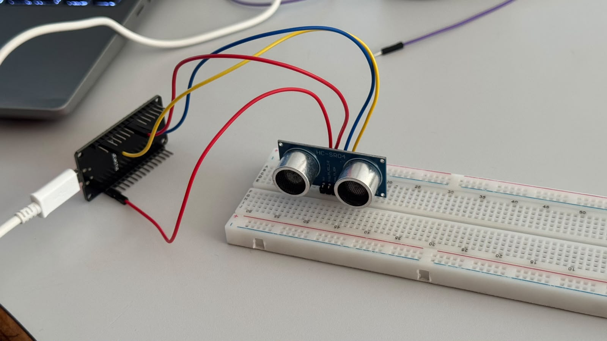
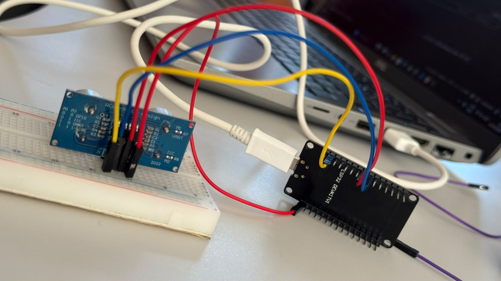
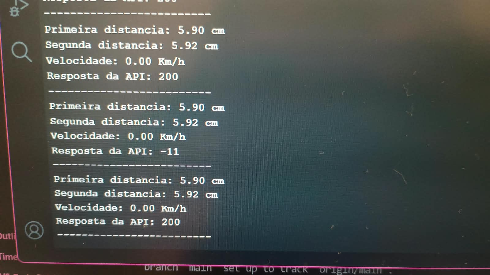

# SENSOR DE ULTRASSOM

Protótipo IoT desenvolvido para detectar a distância de pessoas ou objetos utilizando um sensor ultrassônico. O projeto também calcula a velocidade de aproximação ou afastamento e envia os dados coletados para uma API em tempo real.

## Imagens do Projeto

### Montagem do circuito



### Monitor Serial



## Objetivo do Desafio

O objetivo é desenvolver um sistema capaz de:

1. Detectar a distância de uma pessoa ou objeto utilizando o sensor ultrassônico.
2. Exibir a distância medida no Monitor Serial.
3. Realizar duas leituras de distância com intervalo de meio segundo (500 ms).
4. Calcular a velocidade com base na diferença entre as duas medições.
5. Identificar se o objeto está se aproximando ou se afastando.
6. Enviar os dados coletados para uma API em tempo real.

## Componentes Utilizados

- Arduino ou ESP32
- Sensor ultrassônico HC-SR04
- Jumpers
- Protoboard
- Cabo USB
- Computador para programação e monitoramento

## Funcionamento

O sensor ultrassônico emite ondas sonoras e calcula a distância de um objeto pelo tempo que o som leva para retornar após atingir uma superfície.

O sistema realiza duas medições com intervalo de 500 milissegundos. A partir da diferença entre as distâncias, calcula a velocidade do objeto.

- **Aproximação:** quando a distância diminui.
- **Afastamento:** quando a distância aumenta.
- **Parado:** quando não há variação significativa na distância.

Os dados são exibidos no Monitor Serial e enviados para uma API.

## Código
```
#include <WiFi.h>
#include <HTTPClient.h>

const char* rede = "TI_SENAI2";
const char* senhaRede = "senai2025";

const char* urlAPI = "http://192.168.1.139:3000/comandos";

const int pinoTrig = 5;
const int pinoEcho = 18;

unsigned long ultimaConexao = 0;
const unsigned long intervaloConexao = 10000;


float calcularDistancia() {
  for (int i = 0; i < 3; i++) {
    digitalWrite(pinoTrig, LOW);
    delayMicroseconds(2);

    digitalWrite(pinoTrig, HIGH);
    delayMicroseconds(10);
    digitalWrite(pinoTrig, LOW);

    long leitura = pulseIn(pinoEcho, HIGH, 30000);

    if (leitura != 0) {
      float resultado = leitura * 0.0343 / 2;

      if (resultado >= 2 && resultado <= 400) {
        return resultado;
      }
    }

    delay(60);
  }

  return -1;
}

void iniciarWiFi() {
  Serial.println("Iniciando conexao Wi-Fi...");

  WiFi.mode(WIFI_STA);
  WiFi.setAutoReconnect(true);
  WiFi.begin(rede, senhaRede);

  unsigned long inicioConexao = millis();

  while (WiFi.status() != WL_CONNECTED && millis() - inicioConexao < 15000) {
    delay(500);
    Serial.print(".");
  }

  Serial.println();

  if (WiFi.status() == WL_CONNECTED) {
    Serial.println("Conectado com sucesso!");
  } else {
    Serial.println("Falha na conexao.");
  }

  ultimaConexao = millis();
}

void enviarDados(float valor) {
  if (WiFi.status() == WL_CONNECTED) {
    HTTPClient cliente;

    cliente.begin(urlAPI);
    cliente.addHeader("Content-Type", "application/json");

    String dados = "{\"velocidade\":" + String(valor, 2);
    dados += ",\"unidade\":\"cm/s\"}";

    int resposta = cliente.POST(dados);

    Serial.print("Resposta da API: ");
    Serial.println(resposta);

    cliente.end();
  }
}

void setup() {
  Serial.begin(9600);

  pinMode(pinoTrig, OUTPUT);
  pinMode(pinoEcho, INPUT);

  digitalWrite(pinoTrig, LOW);

  Serial.println("Sensor ultrassonico iniciado!");

  iniciarWiFi();
}

void loop() {
  float primeiraLeitura = calcularDistancia();
  unsigned long primeiroTempo = millis();

  if (primeiraLeitura > 0) {
    Serial.print("Primeira distancia: ");
    Serial.print(primeiraLeitura);
    Serial.println(" cm");
  } else {
    Serial.println("Objeto não encontrado!");
  }

  delay(500);

  float segundaLeitura = calcularDistancia();
  unsigned long segundoTempo = millis();

  if (segundaLeitura > 0) {
    Serial.print("Segunda distancia: ");
    Serial.print(segundaLeitura);
    Serial.println(" cm");
  } else {
    Serial.println("Objeto não encontrado!");
  }

  if (primeiraLeitura > 0 && segundaLeitura > 0) {
    float diferenca = abs(primeiraLeitura - segundaLeitura);
    float intervalo = (segundoTempo - primeiroTempo) / 1000.0;

    float velocidade = (diferenca / 100.0) / intervalo * 3.6;

    Serial.print("Velocidade: ");
    Serial.print(velocidade);
    Serial.println(" Km/h");

    enviarDados(velocidade);
  } else {
    Serial.println("Nao foi possivel calcular a velocidade.");
  }

  if (WiFi.status() != WL_CONNECTED &&
      millis() - ultimaConexao >= intervaloConexao) {

    iniciarWiFi();
  }

  Serial.println("-------------------------");

  delay(2000);
}
```
## Tecnologias Utilizadas

- C++ (Arduino)
- IoT
- Sensor ultrassônico HC-SR04
- API REST
- Comunicação HTTP

## Resultado

O protótipo permite acompanhar a distância e a velocidade de movimentação de pessoas ou objetos, demonstrando na prática a integração ent,re hardware, programação e comunicação com APIs.
